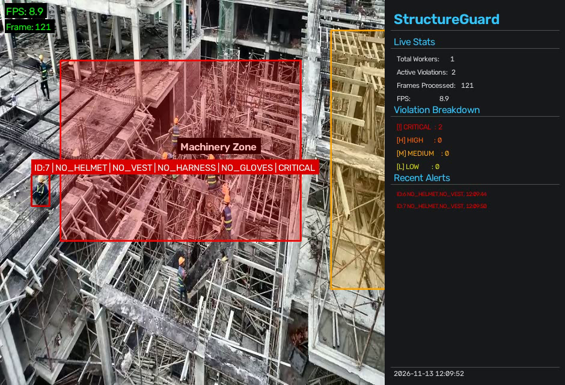
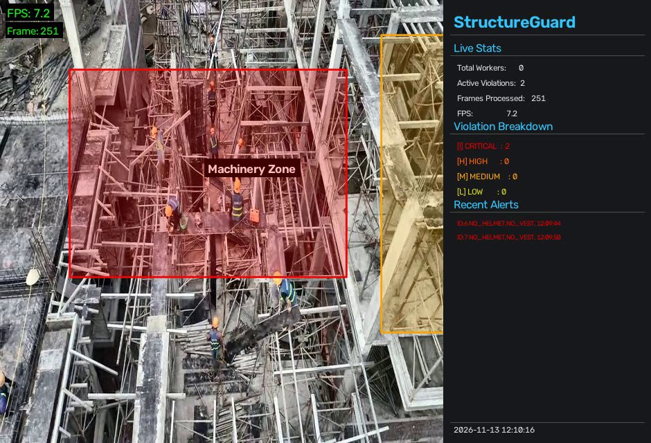
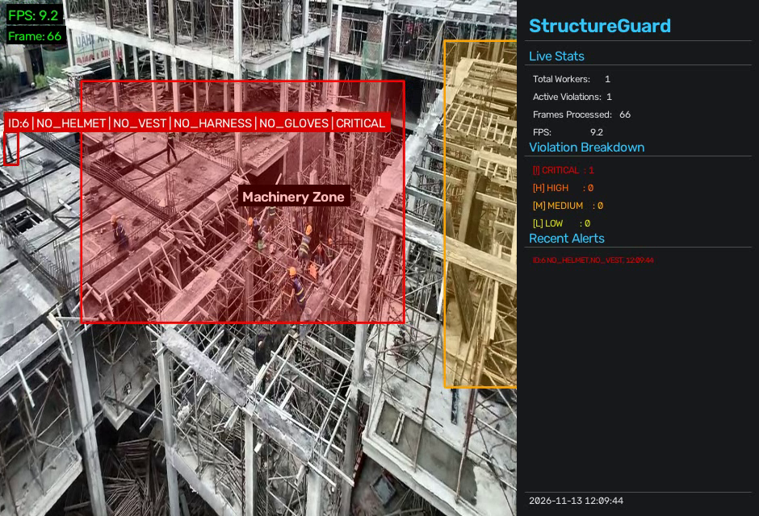
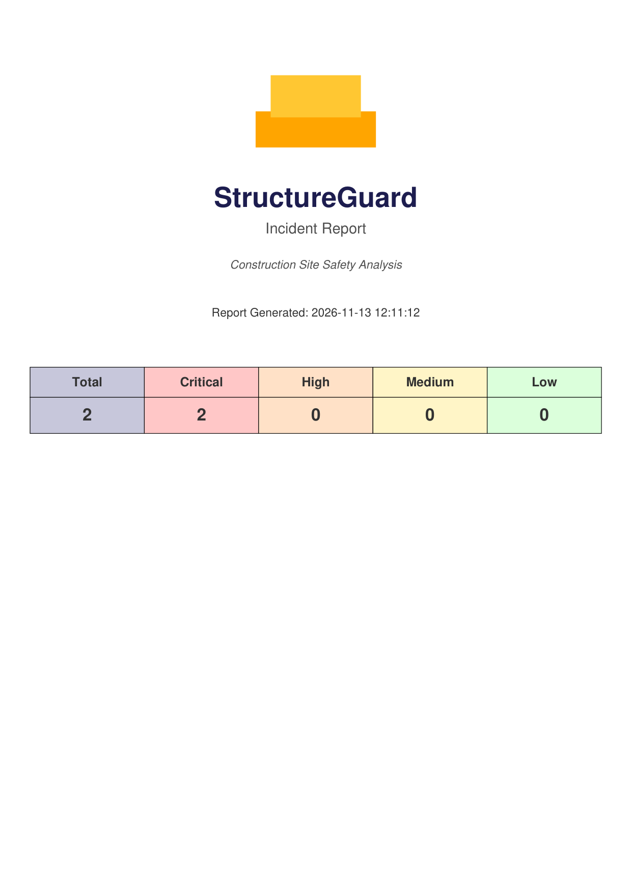
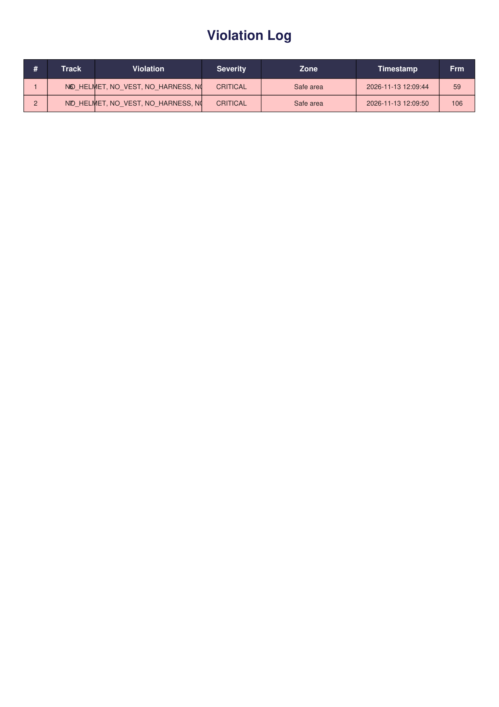
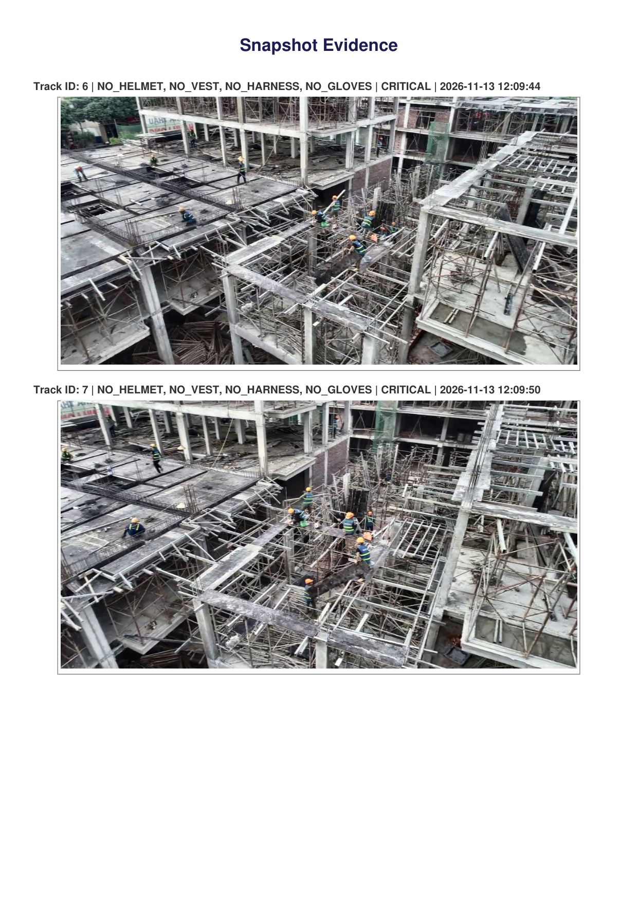
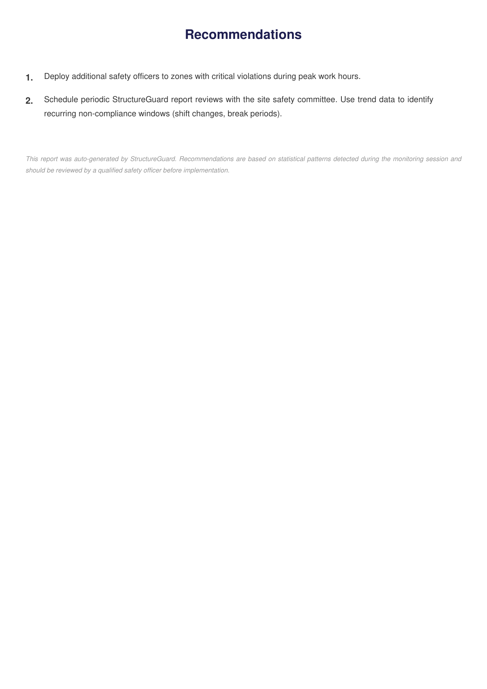
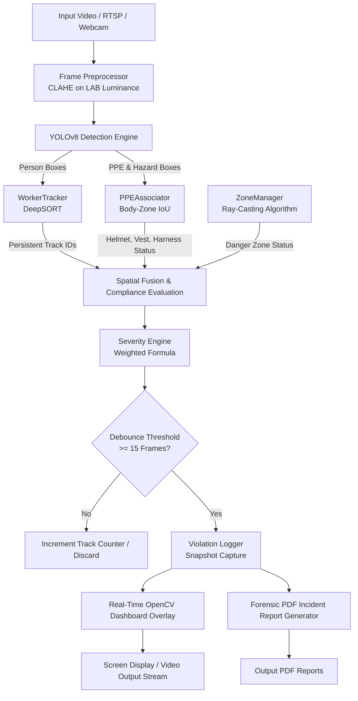

<div align="center">

# 🏗️ StructureGuard
### Real-Time Construction Safety Violation Detection & Tracking System

[](https://www.python.org/)
[](https://pytorch.org/)
[](https://github.com/ultralytics/ultralytics)
[](https://opencv.org/)
[](https://github.com/)
[](LICENSE)

<br/>

**StructureGuard** is an automated, edge-capable computer vision system engineered for proactive occupational hazard prevention. It continuously tracks on-site personnel, evaluates personal protective equipment (PPE) compliance using **Body-Zone IoU Matching**, monitors geometric danger zones with **Ray Casting**, and automatically compiles forensic PDF incident reports with evidentiary frame captures.

[Key Features](#-key-features) • [Screenshots](#-visual-walkthrough--screenshots) • [Architecture](#-system-architecture) • [Algorithms](#-algorithms-in-depth) • [Installation](#-installation) • [Usage](#-terminal-usage) • [Configuration](#-configuration)

---



</div>

---

## 📋 Table of Contents
- [📌 Abstract & Problem Statement](#-abstract--problem-statement)
- [🎯 Key Features](#-key-features)
- [📸 Visual Walkthrough & Screenshots](#-visual-walkthrough--screenshots)
- [📐 System Architecture](#-system-architecture)
- [🧠 Algorithms In-Depth](#-algorithms-in-depth)
  - [1. CLAHE Luminance-Channel Normalization](#1-clahe-luminance-channel-normalization)
  - [2. YOLOv8 Deep Object Detection](#2-yolov8-deep-object-detection)
  - [3. Novel Body-Zone IoU Matching](#3-novel-body-zone-iou-matching)
  - [4. DeepSORT Persistent Tracking](#4-deepsort-persistent-tracking)
  - [5. Ray Casting Danger Zone Detection](#5-ray-casting-danger-zone-detection)
  - [6. Multi-Factor Severity Scoring & Debouncing](#6-multi-factor-severity-scoring--debouncing)
- [🗂️ Project Structure](#️-project-structure)
- [⚙️ Installation](#️-installation)
- [🚀 Terminal Usage](#-terminal-usage)
- [🔧 Configuration Reference](#-configuration-reference)
- [📄 Automated Forensic PDF Reports](#-automated-forensic-pdf-reports)
- [🧪 Test Suite](#-test-suite)
- [👤 Author & License](#-author--license)

---

## 📌 Abstract & Problem Statement

Heavy civil and industrial construction environments present persistent high-consequence safety hazards. Human-led safety audits suffer from observer fatigue, blind spots, and sporadic temporal coverage.

**StructureGuard** provides an autonomous, camera-driven solution by chaining real-time object detection, anatomical body-zone decomposition, persistent multi-object tracking, and ray-casting exclusion zone monitoring. The pipeline eliminates false positives through an adaptive **15-frame temporal debounce** window and produces immutable, auditable **forensic PDF compliance documentation** without human intervention.

---

## 🎯 Key Features

- **⚡ Real-Time High-FPS Pipeline** — Low-latency inference powered by YOLOv8 and vectorized NumPy operations.
- **🧠 Body-Zone IoU Matching** — Novel anatomical partitioning ($Head$, $Torso$, $Lateral$) that accurately maps PPE items to the corresponding individual worker without requiring high-overhead pose estimation networks.
- **🔄 Persistent Worker Tracking** — DeepSORT (Kalman Filter + Hungarian matching + Re-ID embeddings) maintains consistent track IDs across transient occlusions and camera panning.
- **⏱️ Per-Track Temporal Debounce** — 15-frame sliding debounce prevents transient detection flickers from triggering erroneous alerts.
- **🚧 Arbitrary Polygon Danger Zones** — Fast Ray-Casting Point-in-Polygon algorithm monitors hazardous operational zones (heavy machinery swings, scaffolding perimeters).
- **⚖️ Contextual Severity Scoring** — Dynamic threat matrix incorporating violation types, confidence scores, and danger zone presence ($Base \times Zone\_Multiplier \times Confidence$).
- **📊 Real-Time Head-Up Dashboard** — High-contrast OpenCV HUD showing live FPS, worker count, severity metrics, and a real-time scrolling incident feed.
- **📑 Forensic Evidence Logging** — Generates publication-ready, multi-page PDF audit reports containing high-resolution incident snapshots, timestamps, and actionable remediation recommendations.

---

## 📸 Visual Walkthrough & Screenshots

### 1. Live Monitoring & Multi-Worker Tracking
The real-time interface provides real-time situational awareness with color-coded bounding boxes, polygon exclusion zones, and a dark-mode telemetry sidebar.



<div align="center">
  <sub><b>Figure 1:</b> StructureGuard detecting multiple workers with live persistent tracking, active danger zone polygons (Machinery & Scaffold), and incident logging.</sub>
</div>

<br/>

### 2. High-Severity Alert Capture
When a non-compliant worker enters a restricted area or fails PPE verification for $>15$ continuous frames, the system records an alert event and captures an evidentiary frame.



<div align="center">
  <sub><b>Figure 2:</b> Violation confirmation trigger with real-time severity scoring (Critical) and immediate console logging.</sub>
</div>

<br/>

### 3. Forensic PDF Incident Audit Reports
Auto-generated multi-page PDF reports provide full transparency for safety managers, complete with executive summaries, violation breakdowns, and timestamped forensic photographic evidence.

<div align="center">

| Page 1: Cover & Statistical Summary | Page 2: Chronological Violation Log |
| :---: | :---: |
|  |  |

| Page 3: Photographic Evidence Snapshots | Page 4: Automated Safety Recommendations |
| :---: | :---: |
|  |  |

<sub><b>Figure 3:</b> 4-page forensic audit document auto-generated at `output/reports/`.</sub>
</div>

---

## 📐 System Architecture



---

## 🧠 Algorithms In-Depth

### 1. CLAHE Luminance-Channel Normalization
Standard RGB histogram equalization alters chromatic balance, leading to detection artifacts under harsh outdoor sunlight or shadowed scaffolding. StructureGuard transforms frames to the **CIE LAB** space and applies Contrast Limited Adaptive Histogram Equalization (**CLAHE**) strictly on the luminance ($L$) channel:

$$L' = \text{CLAHE}(L; \text{clip}=2.0, \text{grid}=(8, 8))$$

$$\text{Frame}_{\text{out}} = \text{LAB2BGR}(L', A, B)$$

### 2. YOLOv8 Deep Object Detection
A single-stage anchor-free convolutional neural network identifies candidate bounding boxes:
$$\mathcal{B} = \{[x_1, y_1, x_2, y_2, c, s]\}$$
Non-Maximum Suppression (NMS) with an IoU threshold of $0.45$ removes redundant predictions.

### 3. Novel Body-Zone IoU Matching
Generic detection models output disconnected boxes for `person` and `helmet`. Instead of running heavy keypoint/skeleton estimators, StructureGuard decomposes the person bounding box $B_p = [x_1, y_1, x_2, y_2]$ with height $h = y_2 - y_1$:

```
┌─────────────────────────────────────────┐ ◄── y1
│           HEAD ZONE (Top 22%)           │  --> Helmet / Hard Hat
├─────────────────────────────────────────┤ ◄── y1 + 0.22*h
│                                         │
│          TORSO ZONE (22% - 70%)         │  --> High-Vis Safety Vest
│                                         │
├─────────────────────────────────────────┤ ◄── y1 + 0.70*h
│         LATERAL ZONE (60% - 100%)       │  --> Gloves / Hands
└─────────────────────────────────────────┘ ◄── y2
[============= FULL BODY ===============]  --> Fall Arrest Harness
```

Intersection over Union ($\text{IoU}$) with an epsilon guard is computed against target zones:

$$\text{IoU}(Z, B_{\text{PPE}}) = \frac{\text{Area}(Z \cap B_{\text{PPE}})}{\text{Area}(Z \cup B_{\text{PPE}}) + 10^{-6}}$$

An item is verified as worn if $\text{IoU}(Z, B_{\text{PPE}}) \ge \tau_{\text{zone}}$. Negative detections (`no_helmet`, `no_vest`) detected near the region immediately take precedence.

### 4. DeepSORT Persistent Tracking
Maintains stable worker identities through:
- **Kalman Filter**: Predicts state velocity and spatial coordinates:
  $$x = [u, v, \gamma, h, \dot{u}, \dot{v}, \dot{\gamma}, \dot{h}]^T$$
- **Hungarian Algorithm**: Minimizes a dual-cost assignment matrix combining Mahalanobis distance with deep cosine visual appearance embeddings.

### 5. Ray Casting Danger Zone Detection
To evaluate whether worker coordinate $(x, y)$ is within an arbitrary polygon $P = \{v_1, v_2, \dots, v_n\}$:
A horizontal ray is cast from $(x, y)$ toward $+x_\infty$. The crossing count determines inclusion:

$$x_{\text{intersect}} = (x_j - x_i) \cdot \frac{y - y_i}{y_j - y_i} + x_i$$

$$\text{Inside} \iff \sum \mathbf{1}_{\{ \text{edge crosses ray} \}} \equiv 1 \pmod 2$$

### 6. Multi-Factor Severity Scoring & Debouncing
The severity calculation couples violation penalties with environmental hazards:

$$\text{Score}_{\text{base}} = \sum_{v \in \mathcal{V}} w_v \quad \text{where } w \in \{ \text{Helmet: } 80, \text{Harness: } 90, \text{Vest: } 50, \text{Gloves: } 30 \}$$

$$\text{Score}_{\text{final}} = \left( \text{Score}_{\text{base}} \times M_{\text{zone}} \right) \times \overline{\text{Conf}}$$

Categorization thresholds:
- **CRITICAL** $\ge 80$
- **HIGH** $\ge 55$
- **MEDIUM** $\ge 35$
- **LOW** $< 35$

A per-track counter enforces **15 consecutive frames** before an incident is locked into the registry to avoid false alerts caused by motion blur.

---

## 🗂️ Project Structure

```
StructureGuard/
├── assets/                  # High-resolution screenshots & report previews for GitHub
├── core/
│   ├── associator.py        # Anatomical Body-Zone IoU matching engine
│   ├── detector.py          # YOLOv8 inference wrapper
│   ├── preprocessor.py      # CLAHE luminance enhancement module
│   ├── severity_engine.py   # Contextual severity risk engine
│   ├── tracker.py           # DeepSORT tracking wrapper
│   ├── violation_logger.py  # In-memory registry & forensic image persistence
│   └── zone_manager.py      # Ray casting polygon boundary engine
├── reporting/
│   ├── dashboard.py         # Real-time OpenCV HUD overlay
│   └── pdf_reporter.py      # Multi-page forensic PDF generator (fpdf2)
├── sample_videos/           # Test video repository
│   └── test_clip.mp4        # Sample construction site footage
├── tests/                   # Pytest test suite (26 unit tests)
│   ├── test_associator.py
│   ├── test_severity_engine.py
│   └── test_zone_manager.py
├── output/                  # Generated assets
│   ├── annotated_videos/    # Processed MP4 videos
│   ├── reports/             # Timestamped forensic PDF reports
│   └── snapshots/           # Photographic violation captures
├── config.yaml              # Centralized configuration (zero hardcoding)
├── main.py                  # CLI entry point
├── requirements.txt         # Pinned production dependencies
└── .gitignore               # Clean repository exclude rules
```

---

## ⚙️ Installation

### 1. Clone the Repository
```bash
git clone https://github.com/akashnarayanan007/StructureGuard.git
cd StructureGuard
```

### 2. Set Up a Virtual Environment
```bash
# Windows (PowerShell)
python -m venv venv
.\venv\Scripts\Activate.ps1

# Linux / macOS
python3 -m venv venv
source venv/bin/activate
```

### 3. Install Dependencies
```bash
pip install --upgrade pip
pip install -r requirements.txt
```

> [!NOTE]
> `yolov8n.pt` weights auto-download on initial execution. For GPU acceleration, ensure your CUDA toolkit matches your PyTorch installation.

---

## 🚀 Terminal Usage

### Basic Run with UI (Sample Video)
```bash
python main.py --source sample_videos/test_clip.mp4 --save-video --report-now
```

### Run on Live Webcam
```bash
python main.py --source 0
```

### Run Headless / Server Mode (No GUI)
```bash
python main.py --source sample_videos/test_clip.mp4 --no-display --save-video --report-now
```

### CLI Arguments Reference

| Option | Type | Default | Description |
| :--- | :---: | :---: | :--- |
| `--source` | `str` | `0` | Path to video file (`.mp4`, `.avi`) or `0` for live webcam |
| `--config` | `str` | `config.yaml` | Path to master configuration YAML |
| `--save-video` | `flag` | `False` | Encodes and saves annotated output video to `output/annotated_videos/` |
| `--report-now` | `flag` | `False` | Forces compilation of the forensic PDF report upon completion |
| `--no-display` | `flag` | `False` | Runs without the OpenCV GUI window (optimal for server / headless environments) |

---

## 🔧 Configuration Reference

All operational thresholds are managed dynamically in `config.yaml`:

```yaml
model:
  weights: "yolov8n.pt"
  confidence_threshold: 0.40
  iou_threshold: 0.45
  device: "cpu"                  # Options: "cpu", "cuda"

tracking:
  max_age: 30
  n_init: 3
  max_iou_distance: 0.7
  debounce_frames: 15            # Consecutive frames before alert dispatch

zones:
  danger_polygons:
    - name: "Machinery Zone"
      points: [[100,100], [500,100], [500,400], [100,400]]
      color: [0, 0, 255]
    - name: "Scaffold Zone"
      points: [[550,50], [780,50], [780,480], [550,480]]
      color: [0, 165, 255]

severity:
  no_helmet_base: 80
  no_vest_base: 50
  no_harness_base: 90
  no_gloves_base: 30
  zone_multiplier: 1.5           # Amplification factor inside hazard zones
```

---

## 📄 Automated Forensic PDF Reports

Every session generates an auditable PDF compliance report featuring:
1. **Executive Summary** — Total frames processed, unique personnel tracked, total alerts raised, and severity metrics.
2. **Tabular Incident Registry** — Chronological audit trail specifying Track ID, Timestamp, Specific Infractions, Danger Zone presence, and Calculated Risk Score.
3. **High-Resolution Evidence Plates** — Time-stamped visual crops captured at the moment of violation confirmation.
4. **Actionable Recommendations** — Rule-based corrective guidance targeting frequent infractions.

---

## 🧪 Test Suite

StructureGuard includes unit test coverage spanning algorithm edge cases, degenerate polygons, and spatial IoU limits:

```bash
python -m pytest tests/ -v
```

```
============================= test session starts =============================
collected 26 items

tests/test_associator.py .......                                         [ 26%]
tests/test_severity_engine.py ..........                                 [ 65%]
tests/test_zone_manager.py .........                                     [100%]

============================= 26 passed in 4.88s ==============================
```

---

## 👤 Author & License

- **Author**: **Akash** — B.Tech Artificial Intelligence & Data Science
- **License**: Released under the [MIT License](LICENSE).
